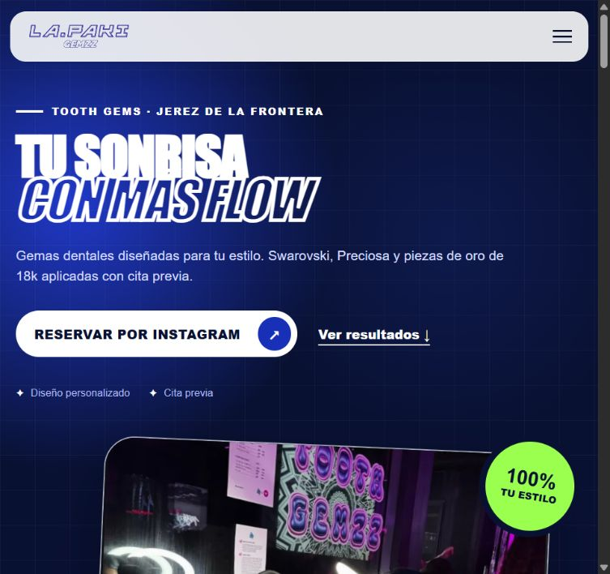

# LA.PAKI GEMZZ

Web de gemas dentales en Jerez de la Frontera. Un escaparate visual con trabajos, catálogo, cuidados y contacto para reservar por Instagram.

**[Ver la web](https://andreszambranalinares-stack.github.io/lapakigemzz/)** · [Código](https://github.com/andreszambranalinares-stack/lapakigemzz)



## Qué incluye

- Diseño adaptable a móvil y escritorio, con menú móvil.
- Galería de trabajos con filtros y ampliación de fotografías.
- Catálogo descargable en PDF.
- Información de cuidados y enlaces de reserva por Instagram.
- Navegación por teclado, textos alternativos y opciones de movimiento reducido.

## Ejecutar en local

No requiere instalación de dependencias ni compilación. Clona el repositorio y abre `index.html` en el navegador, o sirve la carpeta con un servidor estático.

```sh
git clone https://github.com/andreszambranalinares-stack/lapakigemzz.git
cd lapakigemzz
```

## Estructura

| Archivo o carpeta | Contenido |
| --- | --- |
| `index.html` | Contenido y estructura semántica. |
| `styles.css` | Diseño, adaptación a pantallas y animaciones. |
| `app.js` | Menú, filtros, galería y animaciones de entrada. |
| `assets/` | Logotipo, fotografías y catálogo PDF. |
| `docs/` | Captura de presentación. |

**HTML · CSS · JavaScript**, sin frameworks.

## Versión del proyecto

El HTML, CSS, JavaScript y los recursos de la web corresponden exactamente a la versión 2 publicada en Sites, recuperada el 14 de octubre de 2026. Este es el repositorio público principal del proyecto; las versiones anteriores se conservan en el historial y en repositorios privados.

Las fotografías, el logotipo y el catálogo forman parte de la identidad de LA.PAKI GEMZZ; su presencia aquí no concede permiso de reutilización.

Desarrollado por **Andrés Zambrana Linares**.
